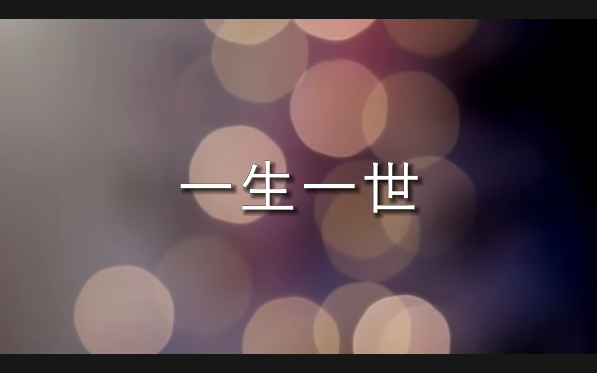
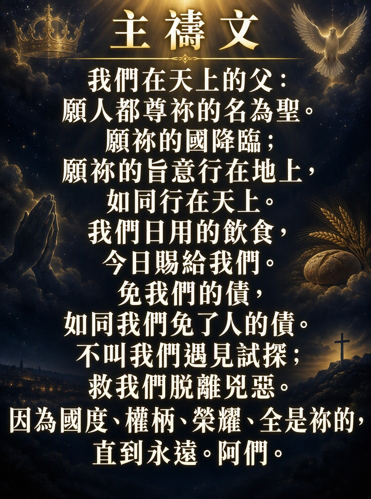
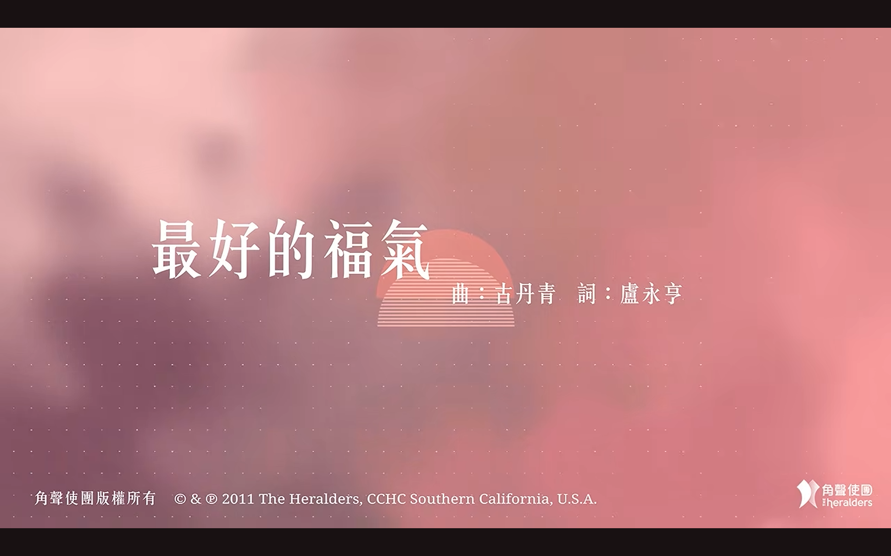
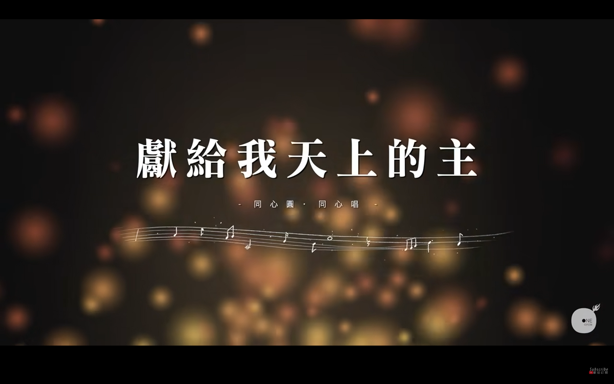
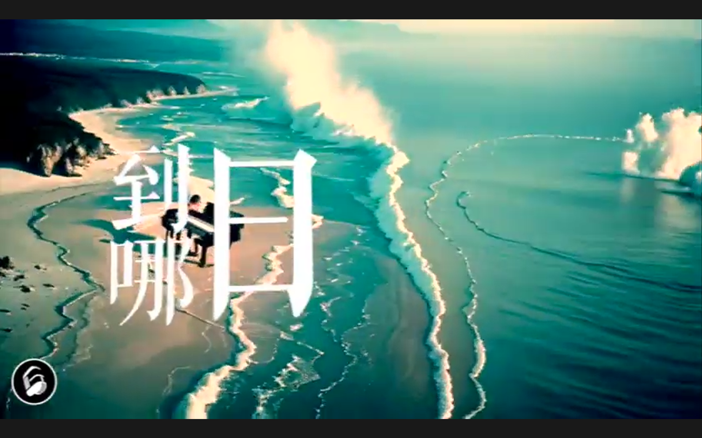
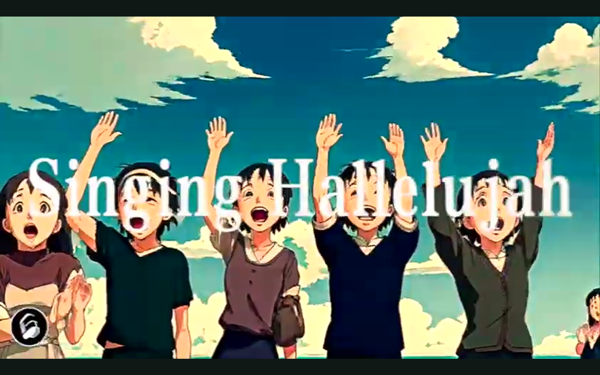

# ...

## 一生一世 - 我心旋律

[](https://youtu.be/RCE4mZz8Cbk?si=i7JYYJOdDxpLtIQz)

---

<div style="height: 600px;"></div>

---

# 主禱文


<p style="text-align: center;">

</p>


---

<div style="height: 600px;"></div>

---

# 1

* 今天我想跟大家分享幾首我喜歡的歌。
* 第一首 ... `我們的神`
* 正如 `羅馬書 1:20` 所說
  - ***自從造天地以來，神的永能和神性是明明可知的，雖是眼不能見，但藉著所造之物就可以曉得，叫人無可推諉。***
* 我們所信仰的神並沒有躲避我們，而是透過祂所創造的一切向我們顯明祂的存在。  
* 例如 ... 你有沒有想過 ...
  - 為什麼即使不欣賞藝術的人，也會驚嘆於日出日落的美麗？
  - 為什麼人們看到星空，驚嘆星空非壯麗。
* ... 這證明人們心中早已存在對神「無可推諉」的概念。
* ... 這證明人應當知道上帝創造了一切。
* `我們的神` ... 如果你認識這首歌並且會唱，請跟著唱。


## 我們的神

[](https://youtu.be/2vCYXbbq8mw?si=b76r8syc7aniHMDK)


```
諸天說述，神榮耀璀璨，造物奇妙，讓蒼生驚嘆，
伸手賜下，無窮盡恩惠，統管四方，權能越過天際。
神，我的主，榮耀寶座前，列國俯伏敬拜，至高的你，
神，我的主，誰又可媲美，頌讚，公義，聖潔，權柄，都歸於你。
你話語，創建一切，看萬有，無從推諉，
峻嶺吶喊，大海呼應，頌唱哈利路亞。
神，我的主，榮耀寶座前，列國俯伏敬拜，至高的你，
神，我的主，誰又可媲美，頌讚，公義，聖潔，權柄，都歸於你。
```

---

<div style="height: 600px;"></div>

---

# 2

* 我記得小時候，在教會做禮拜唱詩的時候，我一定會加入，也會站起來唱，但通常不會大聲唱，也不太投入。
* 不是我不會唱歌，事實上，恰恰相反，我的歌喉還不錯。我不大聲唱，只因為「不想唱」。	
* 直到有一天，一句聖經經文突然浮現在我的腦海中。這句經文是： `路加福音 19:40`
  - *... 耶穌騎驢進入耶路撒冷 門徒很多的信徒都大聲歡呼讚美主 但法利賽人就同耶穌說 「叫你的門徒細聲點。」 ...*
  - ***耶穌說：「我告訴你們，若是他們閉口不說，這些石頭必要呼叫起來。」***  
* 我心想:如果一塊沒有生命的石頭都會高聲讚美上帝；那麼，作為一個按照上帝的形象創造的活生生的人，我應該更多的榮耀我們的創造主呢？	  
* 從那時起，我開始明白我需要讚美神，因為祂配得我的讚美，而我被創造就是要讚美祂的。
* 讚美的一種方式，也是最簡單的讚美方式，就是歌唱；要大聲歌唱，感謝我們的主耶穌基督 -- 我們的救主，我們的主，我們的神


## 感謝一生有祢

[](https://youtu.be/kF-xR8Z04p4?si=maZd3k322MMrF0rP)


```
抬頭看看是一片藍天
真的很美 但不時也有轉變
* 有起有跌 是祢給我的試鍊
* 挑戰靠著祢一定會走完
我雖走過死蔭的幽谷
卻不驚怕 有祢與我同在
祢的杆 祢的杖都安慰我
一生一世必有恩惠慈愛隨著我
這一生很美只因有祢
感謝祢賜下萬有生氣
望望四周花草散發出旋律都很美
我願將我所有奉上給祢
這一生很美只因有祢
感謝祢賜下萬有福氣
* 縱使變遷 也不掛牽
* 因我一生仰望祢的臉
抬頭看看是一片藍天
真的很美 但不時也有轉變
有起有跌 是祢給我的試鍊
挑戰靠著祢一定會走完
我雖走過死蔭的幽谷
卻不驚怕 有祢與我同在
祢的杆 祢的杖都安慰我
一生一世必有恩惠慈愛隨著我
這一生很美只因有祢
感謝祢賜下萬有生氣
望望四周花草散發出旋律都很美
我願將我所有奉上給祢
這一生很美只因有祢
感謝祢賜下萬有福氣
縱使變遷 也不掛牽
因我一生仰望祢的臉
這一生很美只因有祢
感謝祢賜下萬有生氣
望望四周花草散發出旋律都很美
我願將我所有奉上給祢
這一生很美只因有祢
感謝祢賜下萬有福氣
縱使變遷 也不掛牽
因我一生仰望祢的臉
縱使變遷 也不掛牽
因我一生仰望祢的臉
因我一生仰望祢的臉
```


---

<div style="height: 600px;"></div>

---

# 3

* 我已經由壯年 漸漸地進入 銀髮老年一族 同大家成為「老友記」
* 所以我諗 我應該有資格 「想當年」 去記起 在這麼多 「春夏秋冬」 裏面 神給我的各樣恩典


## 陪我走過春夏秋冬

[](https://youtu.be/d2IP-JO2ueM?si=lpaNQgInJ1lCLDyd)

```
歷經風浪人生中，更清楚你在保守，
在過去和永遠，仍是信靠你恩手，
度過歲月成長中，更加深切慕恩主，
是你慰藉憐憫我，主耶穌。
你說始終會伴我秋冬春與夏，
疼我，保守我，引導一生，
信靠恩主哪懼怕經多少變幻，
信靠主我神 永遠被懷抱。
* 你永不捨棄我，永遠與我一起，
* 深宵清早你亦陪我過，
過去今天如何，有你恩典加多，
這一切也靠著神跨過。
```

---

<div style="height: 600px;"></div>

---

# 4

* 在年青的時候 都唱過很多的詩歌 其中一首就是 `親愛主，牽我手` ... 到天庭, 我們終極的家


## 親愛主，牽我手 聖詩介紹

[青年聖歌故事、聖詩共賞：親愛主、牽我手](https://youtu.be/BU3SXTLvMpc?si=Job2uLdrehAP39bi)


## 親愛主、牽我手

[](https://youtu.be/dqcifxe2L-s?si=U5N0EyJ0-qmLHDRx)


```
親愛主，牽我手，建立我，領我走；
我疲倦，我軟弱，我苦愁；
經風暴，過黑夜，求領我進光明，
親愛主，牽我手，到天庭。
我道路，雖淒涼，主臨近，慰憂傷；
我在世快打完美好杖，
聽我求，聽我禱，攙我手，防跌倒；
親愛主，牽我手，常引導。
親愛主，牽我手，建立我，領我走；
我疲倦，我軟弱，我苦愁；
經風暴，過黑夜，求領我進光明，
親愛主，牽我手，到天庭。
```


---

<div style="height: 600px;"></div>

---

# 5

* 人的一生中，會經歷大大小小的苦難 ... 在所有這些苦難中，耶穌都在這裡安慰我們。
* 這份價值連城的祝福，是人一生中能得到的最好的祝氣。


## 最好的福氣

[](https://youtu.be/HcpvUZoIv70?si=o6nUa2c4LtmM0dK4)


```
願我的心讚頌我的主，願唱出讚美感恩的話語，
在你恩典中，幾多的好處，清早到晚上也未停住，
藏在你帳幕的隱密處，渴想一心盡力愛主。
* 也許一生多困苦，被世間撇棄恨惡，
* 但你總看顧，樂意攙扶，愁悶慨嘆變作歡呼，	
人海中多昏暗迷糊，但我的心始終堅固，
投靠你，便覺恩典豐富。
* 也許心中感痛悲，甚至失去了力氣，
* 讓我抓緊你，熱暖的手臂，攜著我再振翅高飛，
人海中雖顛沛流離，但你應許不捨不棄，
投靠你，是最好的福氣，
全賴有著你，才令這生極美。
```


---

<div style="height: 600px;"></div>

---

# 6


* 當然，我不僅關心今生，更加關心永恆。 
* 重點是 ... 我們的罪已得赦免 ... 我們擁有永恆 ... 不僅永恆的生命 ... 我們更被稱為神的兒女 (宇宙的主人的兒女)。
* 所以要回應神給我們的一切恩典，我們需要唱歌讚美我們的神 (我們的主) -- 願讚美崇揚都一一歸給你，主你是偉大完美 


## 獻給我天上的主

[](https://youtu.be/0rh6R51MRls?si=WKGb6X2kia7a3zNs)


```
在我心中有千百萬心聲，來呈獻給我天上的主。
願讚美崇揚都一一歸給你，主你是偉大完美。
在我心中有數不盡感恩，來呈獻給我天上恩主。
願見證傳揚主恩典多麼美，感激你常顧念扶持。
齊真心呈獻讚美給你，盡我心意頌唱每篇的詩句；
* 齊舉手呈獻敬拜永遠歸給你，為你我獻上頌讚。
為你我獻作活祭。讓我永化作活祭。
```


---

<div style="height: 600px;"></div>

---

# 7

* 我不僅關心今生，`到哪日` 就是我們榮耀盼望的那日

```
...
樂奏起天軍讚美
萬國都屈膝向地
...
過去的終於過去
祢抹乾所有眼淚
...
```

## 到那日

[](https://youtu.be/9BL1pMD0Uo8?si=otuB123ywiUfCFk8)


```
[Verse 1]
到那日我站於玻璃海
到那日晝夜唱聖哉
樂奏起天軍讚美
萬國都屈膝向地
我望見座前是我主一張臉
[Verse 2]
到那日我列身眾聖民
到那日我明了救恩
過去的終於過去
祢抹乾所有眼淚
一切更新了祢聖光今普照
[Chorus]
悠揚歌聲諸天都可聽
永永遠遠也為榮耀祢聖名
隨着天兵宣稱主得勝
四處敬拜這天籟聲永沒停
```

* 最後 我希望你心中留下幾句話 ... 為了你們自己；也為了你們身邊的人 ...
* 最後幾句英文句子 ...


***Here I am*** -- ***我在這裡***


***Here you are*** -- ***你在這裡***


***Singing Hallelujah*** -- ***唱哈利路亞***



