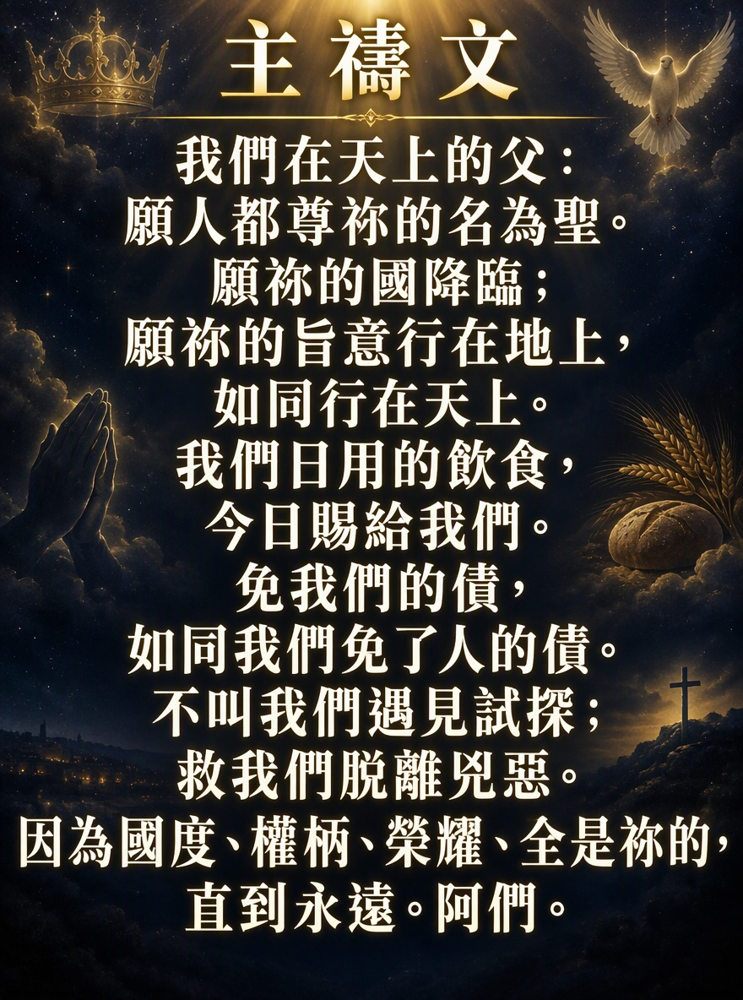
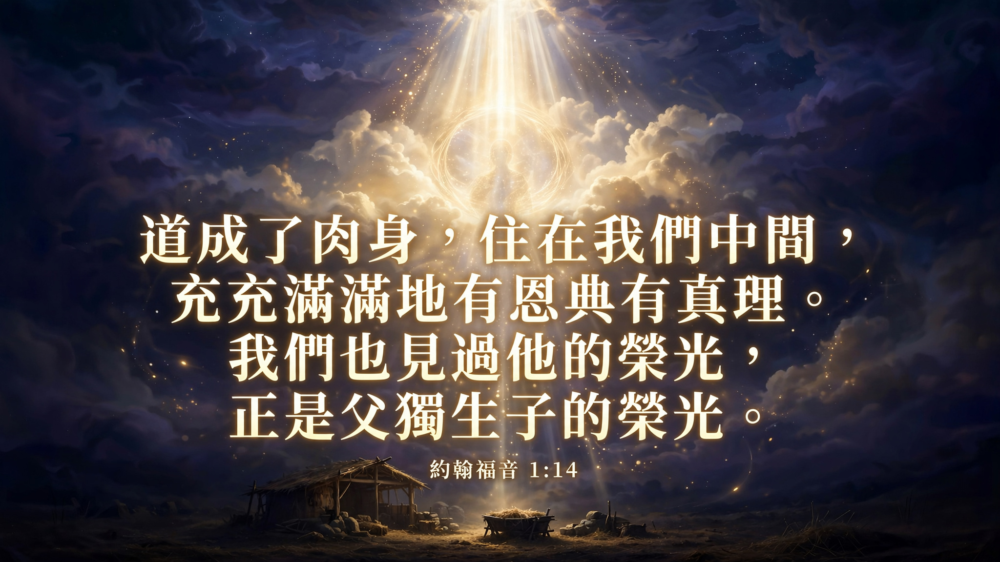
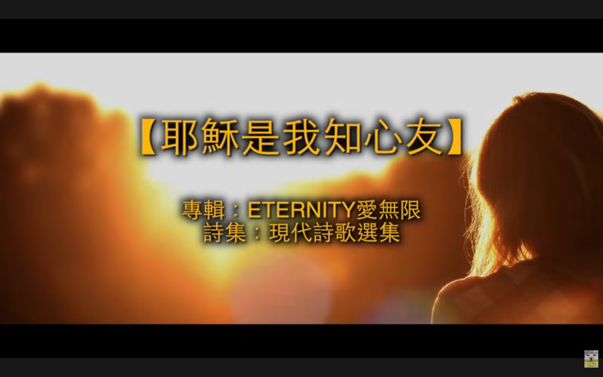
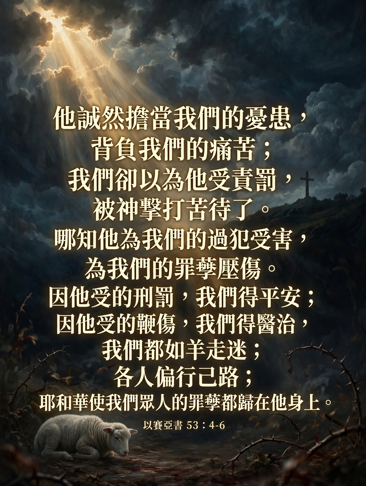
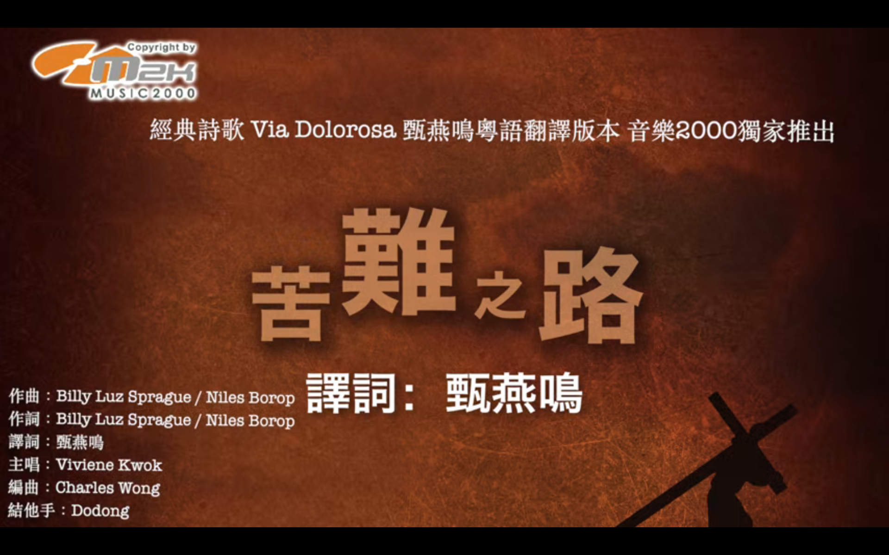
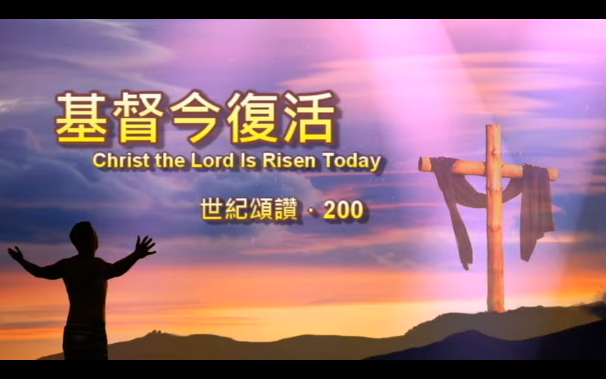

# ...


## 耶穌生平72首讚美詩

[](https://www.youtube.com/watch?v=b3CdoX5Qvvg)

---

<div style="height: 600px;"></div>

---

# 主禱文


<p style="text-align: center;">

</p>

***我們在天上的父***

...

***因為國度、權柄、榮耀，全是祢的***


# 1

* 主禱文是耶穌教導我們如何向天父禱告 ... 那麼，耶穌是誰呢？ 
* 耶穌，祢是誰?

***約翰福音 1:14***
```
道成了肉身，住在我們中間，充充滿滿地有恩典有真理。我們也見過他的榮光，正是父獨生子的榮光。
```




* 今天將分享一些關於耶穌基督生平的歌曲。
* 第一首 ... `耶穌豈是凡人`
* *想唱就跟著唱，不想唱的話，就單純聽就好。*


## 耶穌豈是凡人

[](https://www.youtube.com/watch?v=OF1Y8tYd6E4&list=RDOF1Y8tYd6E4&start_radio=1)

```
何因被祂所惑困？感微妙我心靈更新；
耶穌祂只是凡人，因何令我心靈堅穩？
何因被祂所惑困？心靈內似春雷震撼。
耶穌祂只是凡人，竟然令世界變更。
聽，祂每一句話，能帶有大能力。
我默然地想，默想那每一句話。

何因祂敢於面對？祂行事卻出塵脫俗；
耶穌祂只是凡人，竟然為我舒懷解困！
耶穌祂顯出大愛，點燃著我心頭的光。
耶穌祂豈是凡人，欣然地復活再生。
看，祂每一舉動，除去了苦與憂。
我默然地想，十架那每一顆淚。
看，祂的眼神，神態更具寧靜。
我默然地呼，耶穌我更加想念你。
```


---

<div style="height: 600px;"></div>

---


# 2

*　在我年輕的時候，在教會團契裡，我們常唱`耶穌是我‵知心友`


## 耶穌是我‵知心友

[](https://www.youtube.com/watch?v=3duylp_xKPI&list=RD3duylp_xKPI&start_radio=1)


```
耶穌是我的知心友 祂知道我深透
細心帶領我向天路走 祂牽扶著我手
我向祂傾訴我憂與愁 我信祂必去困憂
永記祂因我將寶血流 我靈得拯救
耶穌是我的知心友 明我祈求或苦與憂
神到處將我施恩救 慈愛永遠伴我走
在這世界道路多歧途 誰明白我主恩高
曾為我要被死煎與熬 神奇恩我仰慕
我向祂低首向祂渴求 要帶福音往遠處走
願我一生一世跟主腳步 完成主使命
耶穌是我的知心友 明我祈求或苦與憂
神到處將我施恩救 慈愛永遠伴我走
在這世界道路多歧途 誰明白我主恩高
曾為我要被死煎與熬 神奇恩我仰慕
願這福音恩光遍地球 為人所接受
```

***永記祂因我將寶血流 我靈得拯救***


# 3

* 耶穌是我的知心友 ... 因為祂救了我。
* 這份救恩，是人們長久以來所渴望的 ... 從以色列人 ... 到所有的人

***羅馬書 1:16***

```
我不以福音為恥；這福音本是神的大能，要救一切相信的，先是猶太人，後是 希臘人。
```

*猶太人指的是以色列人。*
*希臘人指的是非猶太人，也就是外邦人。*


* 下一首歌是 ... `以馬內利來臨`
* 誰是以馬內利？

以賽亞書 7:14
```
因此，主自己要給你們一個兆頭：必有童女懷孕生子，給他起名叫以馬內利。
```

## 以馬內利來臨

[](https://www.youtube.com/watch?v=3Vq-5jl1vr4&list=RD3Vq-5jl1vr4&start_radio=1)

```
以馬內利，懇求降臨，救贖釋放以色列民；
淪落異邦，寂寞傷心，引頸渴望神子降臨。

耶西之條，懇求降臨，撒但手中，釋放子民；
地獄深處，拯救子民，使眾信徒勝過死亡。

清晨日光，懇求降臨，藉主降臨，歡慰眾心；
衝開長夜幽暗愁雲，驅散黑影進入光明。

大衛之鑰，懇求降臨，大開我眾天上家庭；
安排我眾登天路程，斷絕人間多愁苦徑。

副歌：歡欣！歡欣！以色列民，以馬內利，定要降臨！
```


# 4

* 耶穌在三十歲時出來傳道。
* 耶穌講過很多比喻，其中一個是`浪子的比喻`(***路加福音 15:11-32***)
* 這個比喻講述了一個浪子離家後，最終悔改回到父親身邊的故事，象徵上帝對悔改罪人的接納與愛。
* `浪子的我`，正是每一個在罪中迷失的人，而父親的愛，正是上帝對我們的接納與救贖。
* 這首歌描述了浪子回頭的心路歷程，提醒我們上帝的愛無條件地接納每一個悔改的人。


## 浪子的我

[](https://www.youtube.com/watch?v=dhP3ejJYa7s&list=RDdhP3ejJYa7s&start_radio=1)


# 5

* 耶穌在三十三歲時，為了我們的罪被釘在十字架上。

***以賽亞書 53:4-6***

```
他誠然擔當我們的憂患， 背負我們的痛苦； 我們卻以為他受責罰， 被神擊打苦待了。 
哪知他為我們的過犯受害， 為我們的罪孽壓傷。 因他受的刑罰，我們得平安； 因他受的鞭傷，我們得醫治。 
我們都如羊走迷； 各人偏行己路； 耶和華使我們眾人的罪孽都歸在他身上。
```




* 耶穌為我們的罪受苦，承擔了我們的痛苦，這是上帝對我們的愛的極致表現。
* 耶穌為我們走上 ***苦難之路*** Via Dolorosa 
  

## 苦難之路


[](https://www.youtube.com/watch?v=CXFTaBGRomU&list=PLM_OKCfckXn4)

```
人浪翻騰，士兵穿插，千夫指向這個祂，
受死前被鞭打，劇痛掙扎，
昨日歡呼的群眾，正在冷嘲戲弄唾罵欺壓。
遍體傷痕，額角淌血，荊棘冠冕正刺穿，
承受世人罪債的沉重身影，
步步艱辛的路徑，背負四周冷酷肆虐呼聲。

榮耀君王，救主基督，性命以十架結束，
無罪羔羊何故遭宰殺凌辱，
全為愛不退半步，決定走上苦難之路，
殘酷傷害，無悔經過，作犧牲，正為你我。

窄路被血洗，實踐神大計，無價贖罪救恩，發自各各他，
榮耀君王，救主基督，性命以十架結束，
無罪羔羊何故任屠宰侮辱，
為著愛不退半步，決定走上苦難之路，
曾在Via Dolorosa，喝苦杯，正為你我。
```

***全為愛不退半步，決定走上苦難之路，殘酷傷害，無悔經過，作犧牲，正為你我。***

# 6

* 三天後，他復活了。
* 這是上帝對人類罪的最終勝利，象徵著生命戰勝死亡，光明戰勝黑暗。


## 基督今復活

[](https://www.youtube.com/watch?v=GFYeugaAttQ&list=RDGFYeugaAttQ&start_radio=1)


# 7

* 因著耶穌基督，我們擁有這份***榮耀的盼望***。
* `到那日`這首歌描述了末日的景象，信徒在神面前敬拜，萬國都屈膝，所有的眼淚都被抹去。


## 到那日

[](https://youtu.be/9BL1pMD0Uo8?si=otuB123ywiUfCFk8)


```
[Verse 1]
到那日我站於玻璃海
到那日晝夜唱聖哉
樂奏起天軍讚美
萬國都屈膝向地
我望見座前是我主一張臉
[Verse 2]
到那日我列身眾聖民
到那日我明了救恩
過去的終於過去
祢抹乾所有眼淚
一切更新了祢聖光今普照
[Chorus]
悠揚歌聲諸天都可聽
永永遠遠也為榮耀祢聖名
隨着天兵宣稱主得勝
四處敬拜這天籟聲永沒停
```


***Here I am*** -- ***我在這裡***


***Here you are*** -- ***你在這裡***


***Singing Hallelujah*** -- ***唱哈利路亞***


